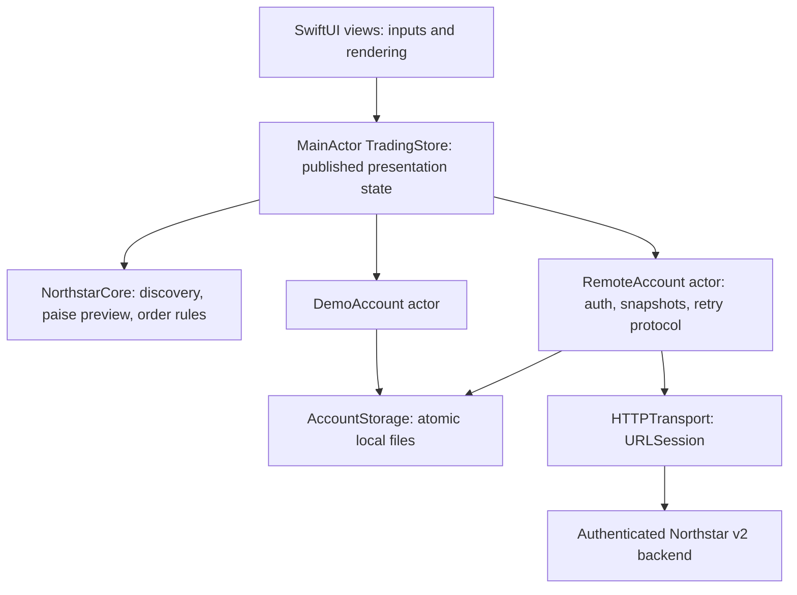

# Learn the native iOS architecture

Start with `ContentView`, then follow `OrderTicketView` → `TradingStore.placeOrder` → `TradingRules` (offline) or `RemoteAccount.submit` (API). This shows a complete user action crossing presentation, domain, persistence and networking boundaries.

The app uses one small Swift package for independent compilation and tests. This is enough separation for the current seven-stock app. Splitting every screen into a package would add navigation and dependency-management work without demonstrated compile-time benefit. Domain code imports Foundation, not SwiftUI or Combine. HTTP and storage use injectable protocols; the UI never knows JSON field names or touches a file from `body`.

| Your Android / Flutter experience | Native iOS equivalent here |
| --- | --- |
| Compose / Flutter widget tree | SwiftUI `View` values; `body` derives UI from state |
| `remember` / local `State` | `@State` for inputs such as search and review state |
| ViewModel + StateFlow / ChangeNotifier | `@MainActor TradingStore`, `ObservableObject`, `@Published` |
| ViewModel lifetime owner / Provider | `@StateObject` in the root; `@EnvironmentObject` in descendants |
| Kotlin coroutines / Dart Future | Structured `async/await`, `Task`, explicit error handling |
| Mutex around a suspending transaction | Actor isolation plus a busy guard spanning awaits |
| Retrofit / Dio | URLSession + Codable DTOs behind `HTTPTransport` |
| Room / DataStore / local JSON | `DemoAccount` and `FileAccountStorage` actors; an injectable storage boundary |
| Navigation Compose / Navigator | `NavigationStack`, `NavigationLink`, native sheets and `TabView` |
| JUnit / Flutter tests | XCTest package tests, Swift Testing presentation tests, XCUITest journeys |
| Gradle module | Swift Package Manager target/product |

## State ownership and concurrency

`@MainActor` protects published UI state, not the network itself. URLSession suspends rather than blocking while bytes travel; disk reads/writes and decoding are owned by package actors. Rendering uses already-loaded memory. State is applied after persistence/server confirmation, not optimistically before an order has completed. Lightweight filtering and formatting remain synchronous; profile before adding background workers to a seven-item catalog.

Actors are reentrant: another call can enter while the first is suspended. `RemoteAccount` therefore holds an explicit busy flag until the whole operation finishes. The package tests overlap load and watchlist calls to verify that guard. A main-actor method alone would not make a multi-request workflow indivisible.

`OrderPreview` uses integer paise for price, total, affordability and cash. Offline cost basis preserves a weighted average; the API's weighted average is server-rounded, and the client displays the server snapshot. The offline engine is for practice and never pretends to authorize a server transaction.

## Security decisions worth discussing

- The source API has password sessions, not a passkey endpoint. No fake passkey control is added.
- Tokens stay in memory to match the source lifecycle. Keychain becomes appropriate if a future backend introduces refresh-token persistence; do not put bearer tokens in UserDefaults or ordinary JSON.
- HTTPS, system certificate trust and ATS remain enabled in Release. Debug has a local-network allowance paired with client validation limiting HTTP to localhost/127.0.0.1 for simulator development. Certificate pinning is deliberately not invented for an unknown deployment. If your threat model requires pinning, choose the production host, use public-key pins with overlap/rotation and recovery plans, and test expiry/rotation before shipping.
- An order UUID is persisted **before** sending. Retaining it after an ambiguous response prevents a second buy when the user retries. The server, not the client, guarantees idempotency and account isolation.
- Offline files and retry records are atomic, excluded from backup and protected on iOS. Retry records contain order intent, never a password or token. Application sandbox storage is not a substitute for server authorization.
- No third-party analytics or broker SDK is included. Sensitive UI is covered when the scene becomes inactive. API failure text is mapped locally rather than exposing server diagnostics.

## Interview walkthrough

1. Show an accepted buy and rejected oversell, and explain why ledger mutation happens only after validation.
2. Explain SwiftUI value views versus reference-owned app state and why only one store owns the account.
3. Demonstrate a timeout after commit, restart, sign-in and same-UUID retry. Contrast an uncertain result with a definitive rejection.
4. Show the real HTTP contract test and why mocked tests alone cannot prove JSON/date/header compatibility.
5. Explain an actor's reentrancy and the explicit operation guard.
6. Describe accessibility and release evidence you have actually gathered. Do not present unrun simulator tests, profiling, or App Store approval as complete.

## Apple learning path

Use [Apple's iOS getting started](https://developer.apple.com/ios/get-started/), [SwiftUI tutorials](https://developer.apple.com/tutorials/swiftui), [Human Interface Guidelines](https://developer.apple.com/design/human-interface-guidelines), [accessibility](https://developer.apple.com/accessibility/), [Swift API Design Guidelines](https://www.swift.org/documentation/api-design-guidelines/), and [App Store review guidelines](https://developer.apple.com/app-store/review/guidelines/) alongside the code.

Study state/data flow first, navigation and layout next, then async/await and actors, persistence/networking, tests, Instruments and release. Try changing a sector filter, writing an error-path test and inspecting allocations during navigation. The linked Apple getting-started page returned HTTP 403 from this workspace; these are learning references, not a claim that live Apple documentation was retrieved or that Apple has reviewed the implementation.
