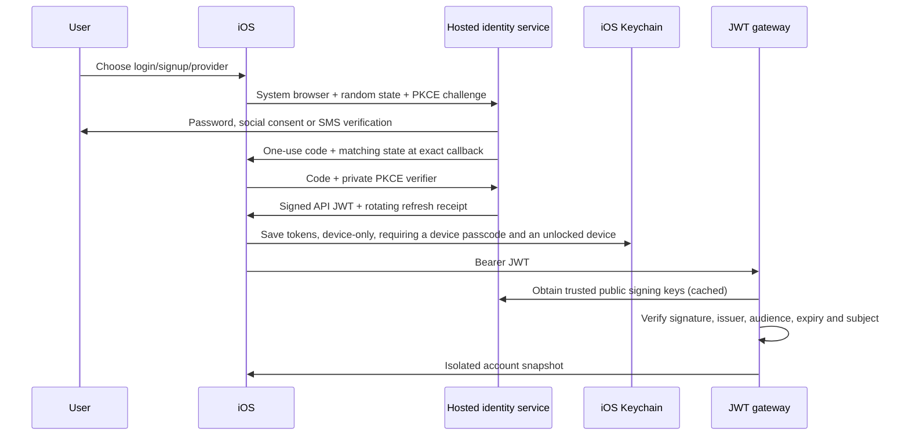

# Authentication setup, costs and trust boundaries

## Choose a path

| Path | What works | Provider cost |
| --- | --- | --- |
| Offline demo | Device-local paper portfolio, orders, watchlist and app lock | No identity service or SMS needed |
| Original localhost API | Username/password signup/login and isolated paper ledgers | No third-party identity service needed |
| Hosted identity gateway | Email signup/login, configurable Google/Facebook/Apple, phone/SMS, JWTs and refresh | Identity-provider plan, optional SMS delivery and eventual hosting costs |

The hosted implementation targets **Auth0-compatible endpoints** (`authorize`, `oauth/token`, `oauth/revoke`). One provider brokers the social and phone connections. Enabling a connection does not require adding another mobile SDK or shipping its secret. Firebase is not an API-key-only drop-in replacement: its phone challenge, session and backend verification contracts differ and would need a separate adapter.

Start with offline or localhost username login at no identity-provider cost. Enable hosted email/social when needed, then SMS last. Check current provider limits and prices before choosing a plan; no live pricing was verified here. SMS commonly has country/carrier delivery charges and abuse risk. Enable country restrictions, rate limits, bot protection, spend limits and billing alerts before making SMS public. Social login may still count toward a hosted provider's active-user billing even where the social network charges no per-login fee. Apple distribution requires your developer account and its applicable enrollment fee.

## Configure hosted login once

1. Create an Auth0 **Native / public** application. Enable Authorization Code, PKCE, rotating refresh tokens, reuse detection and bounded idle/absolute refresh lifetimes. The app contains **no client secret**.
2. Register an API identifier/audience with **RS256** signing and enable offline access. Configure short-lived access tokens. The same audience and issuer must reach the iOS app and gateway.
3. Set the app's final bundle ID. Register its exact callback, `<your.bundle.id>://auth/callback`, in the provider application. `CFBundleURLTypes` uses the bundle ID automatically. Changing the bundle ID requires changing the provider's allowed callback too.
4. Edit **Configuration/Identity.xcconfig**: issuer, public native client ID, API audience and only the connection names you intend to support. URLs in xcconfig use `https:/$()/...` to avoid comment parsing. Do not add provider secrets.
5. Set `NORTHSTAR_API_ORIGIN` in Xcode to the gateway origin: `http://localhost:8000` for Debug Simulator or your HTTPS host for Release. The old opaque-token backend cannot accept hosted JWTs; run the companion gateway from [backend-auth](../backend-auth/README.md).
6. Register and enable the selected provider connections in the dashboard. Typical connection names are `google-oauth2`, `facebook`, `apple` and `sms`, but use the actual connection names from your tenant. An empty connection name hides its button in Release.
7. Create a **different, server-only** machine-to-machine application for account deletion, with least-privilege management authorization such as `delete:users`. Supply its credentials only through server environment settings. A native application's public client ID is not this secret.
8. Verify real signup, login, refresh, revocation, identity linking policy and deletion before release. Dashboard developer/test provider credentials are not a production configuration.

When the issuer is blank, the original localhost form remains available. Debug explains why unconfigured provider options are disabled. Release hides unconfigured provider options. Password confirmation is required for local signup. Hosted signup, password recovery, phone entry, SMS-code validation, resend limits and provider error recovery belong to the hosted identity service; configure and test those hosted screens rather than inventing OTP validation in iOS.

## Provider-specific requirements

- **Google:** register the application/consent configuration and configure the provider callback requested by your broker. Review the scopes and publishing status.
- **Facebook:** create the Meta application and enable its login product/redirect configuration, app mode and required review. Its app secret stays with the identity service.
- **Phone:** configure passwordless SMS, a real SMS provider, appropriate sender/country settings, code expiry and abuse limits. No hardcoded OTP, phone-number trust or fake success path exists in this app. This browser-hosted approach does not use a Firebase native phone SDK, so Firebase APNs/reCAPTCHA files are not part of this implementation.
- **Apple:** configure the Apple developer identifiers, web/Services ID integration and provider callback required by the broker. Hosted Apple login does not use an app-native `ASAuthorizationAppleIDProvider` flow, so adding an unused native entitlement is not a substitute for provider setup. Review current guideline 4.8, branding and account-deletion rules. Verify Apple authorization/token revocation as part of deletion; deleting the broker profile alone is not evidence that the Apple grant was revoked. Configure the broker's supported revocation/action integration or implement the required server-side Apple revocation before shipping Apple accounts.

Adding social login affects App Review. Include the Apple option or another qualifying equivalent where guideline 4.8 applies; do not assume an exemption. The release guard checks the Apple connection when Google/Facebook are selected, but automated settings checks cannot determine legal/policy compliance.

## How a session works

The app can read expiry from the JWT to schedule renewal. Reading its JSON is **not** verifying its signature and never grants a server account. The server alone verifies the cryptographic signature. It only accepts RS256, the configured issuer/audience, required claims and a bounded clock tolerance; it does not fall back to the old opaque-token API.

Refresh occurs before authenticated requests when the access token is near expiry. A rotated refresh receipt is written to Keychain before exposing the new access token. Revoked refresh tokens erase local credentials and require login. Local sign-out erases credentials even if remote revocation fails; existing access JWTs remain usable until their short expiry unless the provider/API implements additional revocation. App-managed deletion tombstones block deleted accounts immediately.

## Face ID and Touch ID

Enable app lock in **Account → Device security** after enrolling biometrics in device Settings and setting a device passcode. iOS offers the supported biometric type; one phone does not generally support both Face ID and Touch ID. The app also accepts the device passcode for recovery after lockout or enrollment changes. This is intentionally device-owner authentication, not biometrics-only protection.

The lock's Keychain item requires user presence and a device passcode, and cannot sync to another device. Backgrounding locks access, and inactive scenes show a privacy cover. UI navigation and store actions consult the same app-owned lock. No sign-out shortcut reveals a locked offline portfolio. Authentication prompts may make the scene inactive, so the app locks on **background**, not every inactive notification. An in-flight unlock result cannot reopen the app after a later background event.

Biometric templates never enter this app or backend. App lock does not prove the identity of a remote account, stop a server from expiring a session, or replace device/security testing. Keychain items can outlive app reinstall on the same device; explicitly sign out to erase identity credentials.

## What still needs real accounts/devices

No provider tenant, social registrations, SMS sender, management secret, production hostname or Apple signing account was supplied. Real social/SMS login and real management revocation/deletion therefore have **not** been exercised. The protocol tests use test tokens; server tests use temporary real RSA keys. Face ID, Touch ID, passcode recovery, Keychain behavior and SwiftUI compilation require macOS/iOS validation. These are release gates, not simulated successes.

Hosted sessions require a device passcode because their Keychain protection uses `WhenPasscodeSetThisDeviceOnly`. If the device has no passcode or it is removed, set one and sign in again; the app does not silently downgrade token storage. Offline and original localhost sessions remain usable without remembering hosted credentials.

Current plan details can change: check [Auth0 pricing](https://auth0.com/pricing), your chosen SMS provider's delivery/verification pricing, and [Apple Developer membership](https://developer.apple.com/programs/) before committing to a production budget. Those links are references, not a verified current price quote.
